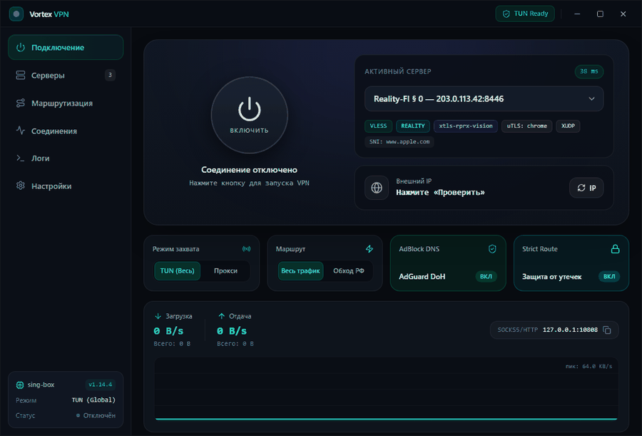
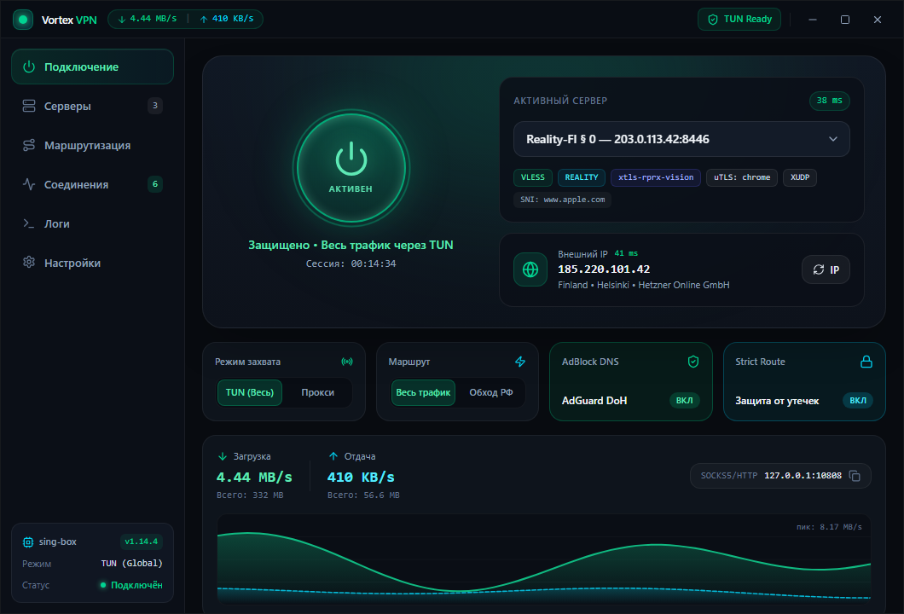
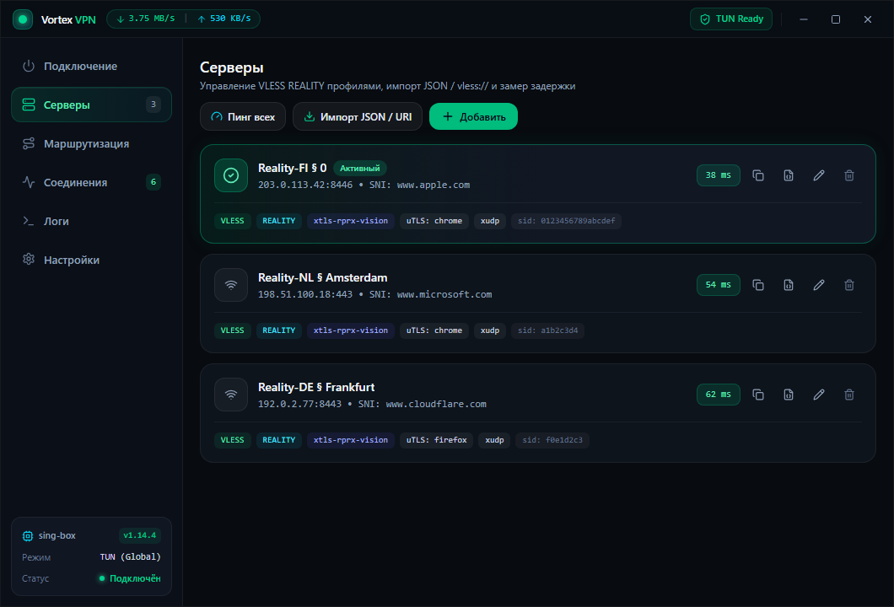
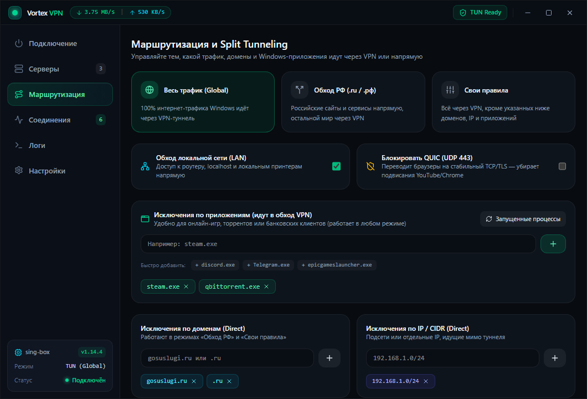
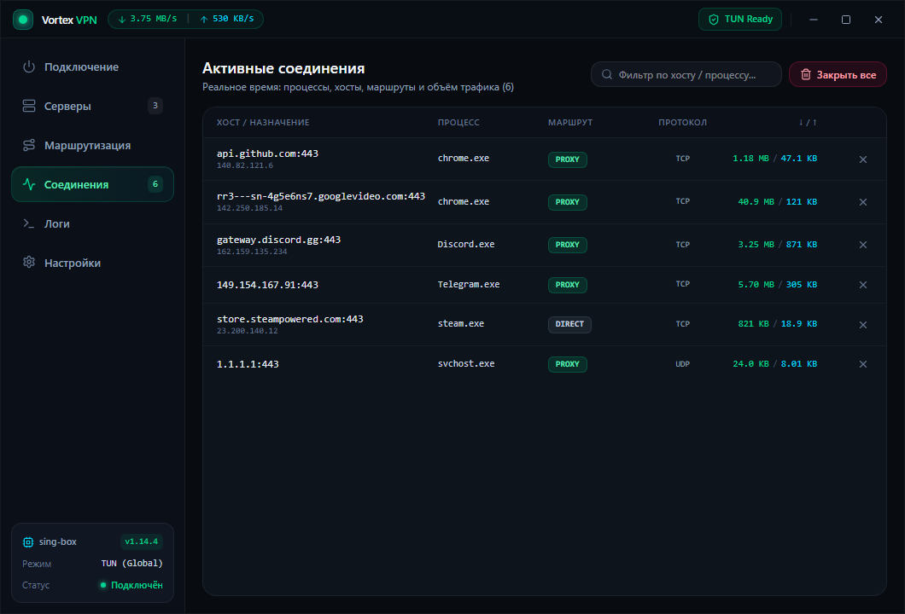
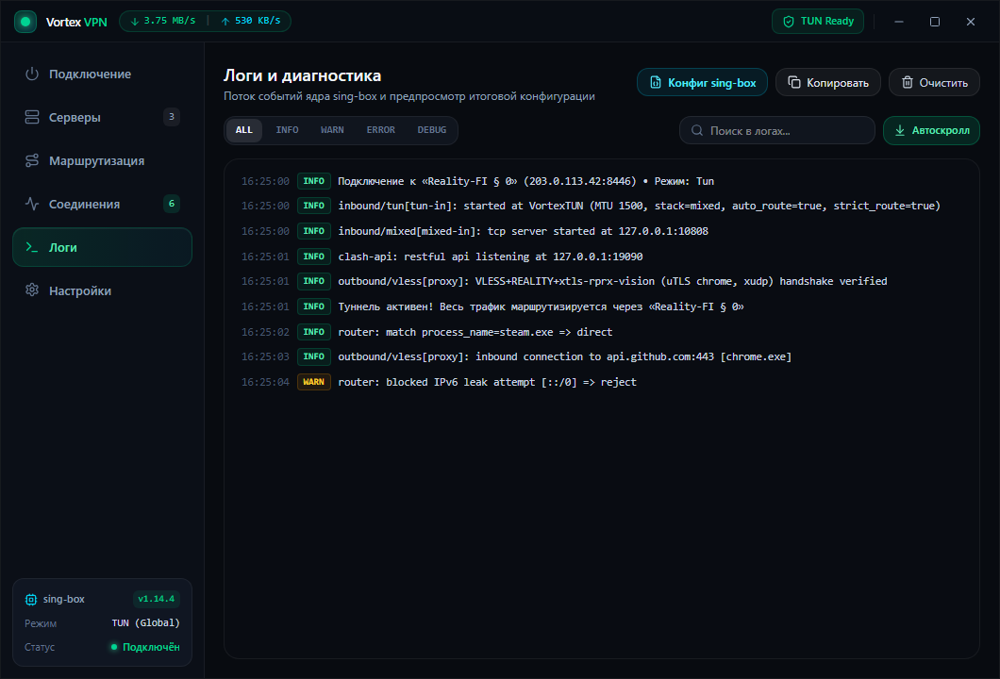
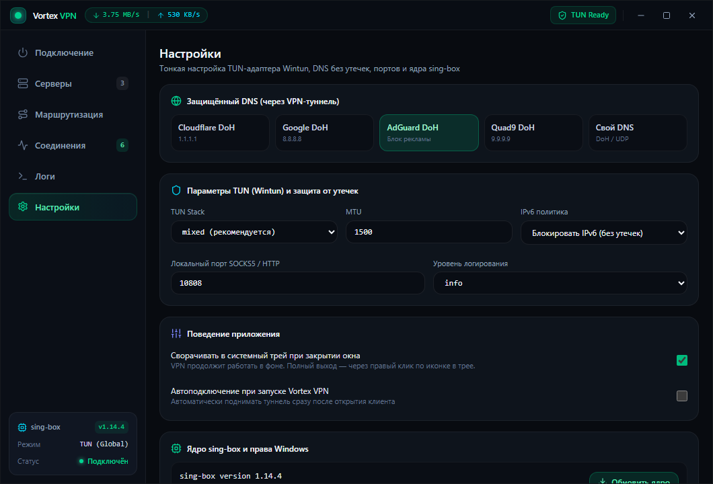

<div align="center">

# Vortex VPN

**Современный нативный VPN-клиент для Windows на Rust + Tauri v2**  
Полная маршрутизация всего системного трафика (Wintun TUN) через **VLESS • REALITY • XTLS-Vision • uTLS • XUDP**



</div>

---

## Ключевые особенности

- **Весь трафик Windows через TUN (`Wintun`)** — `auto_route`, `strict_route` (защита от утечек), `stack: mixed`, перехват и шифрование DNS (`hijack-dns` + Cloudflare / Google / AdGuard AdBlock / Quad9 DoH) и блокировка утечек IPv6.
- **Никакого «сломанного интернета» после краша** — процесс ядра `sing-box` привязан к **Windows Job Object (`JOB_OBJECT_LIMIT_KILL_ON_JOB_CLOSE`)**: при любом закрытии или аварийном завершении ОС сама очищает туннель и сетевые маршруты.
- **Резервный режим Системного прокси** — с автоматическим бэкапом и восстановлением ключей реестра Windows (`WinInet`), плюс локальный `SOCKS5 / HTTP` на `127.0.0.1:10808`.
- **1-клик UAC** — явный индикатор прав администратора (`TUN Ready`) и кнопка перезапуска с повышением привилегий без «тихих отказов».
- **Умный менеджер серверов** — импорт JSON-конфигов `sing-box` (`{ "outbounds": [...] }`) и ссылок `vless://`, визуальный редактор, экспорт, массовый TCP-пинг, проверка внешнего IP и геолокации.
- **Split Tunneling** — режимы **Весь трафик (Global)**, **Обход РФ (.ru / .рф)** и **Свои правила**; исключения по **процессам Windows** (с живым списком запущенных `.exe`), доменам и IP/CIDR, а также блокировка QUIC (UDP 443).
- **Полная наблюдаемость** — живой график скорости (Download / Upload) через Clash API WebSocket, таблица активных соединений с разрывом в 1 клик, фильтруемые логи и предпросмотр итогового `sing-box` JSON.
- **Лёгкий и быстрый** — нативный Rust-бэкенд (~5 MB бинарник) и системный WebView2 вместо тяжёлого Electron, системный трей и авто-загрузка актуального ядра `sing-box` с GitHub.

---

## Скриншоты интерфейса

| Подключение (Dashboard) | Серверы (Profiles) |
| :---: | :---: |
|  |  |

| Маршрутизация и Split Tunneling | Активные соединения |
| :---: | :---: |
|  |  |

| Логи и диагностика | Настройки TUN и DNS |
| :---: | :---: |
|  |  |

---

## Поддерживаемый формат протокола

Клиент из коробки поддерживает импорт и работу с `sing-box` VLESS REALITY конфигами и `vless://` ссылками:

```json
{
  "outbounds": [
    {
      "type": "vless",
      "tag": "Reality-FI § 0",
      "server": "YOUR_SERVER_IP",
      "server_port": 8446,
      "uuid": "YOUR_UUID",
      "flow": "xtls-rprx-vision",
      "tls": {
        "enabled": true,
        "server_name": "www.apple.com",
        "utls": {
          "enabled": true,
          "fingerprint": "chrome"
        },
        "reality": {
          "enabled": true,
          "public_key": "YOUR_REALITY_PUBLIC_KEY",
          "short_id": "YOUR_SHORT_ID"
        }
      },
      "packet_encoding": "xudp"
    }
  ]
}
```

---

## Сборка из исходников (Windows)

Требования: **Rust (`x86_64-pc-windows-msvc`)**, **Node.js 20+**, **WebView2** (встроен в Windows 10/11).

```powershell
# 1. Сборка фронтенда
npm install
npm run build

# 2. Сборка нативного Rust-приложения (UI вшивается в .exe)
cd src-tauri
cargo build --release
```

После запуска `vortex-vpn.exe` при отсутствии локального `sing-box.exe` клиент предложит автоматически скачать официальный релиз `sing-box` с GitHub в 1 клик.
